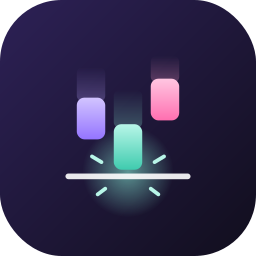
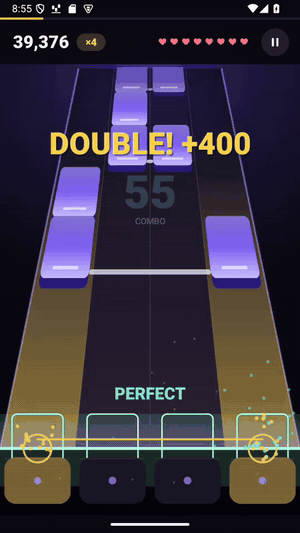
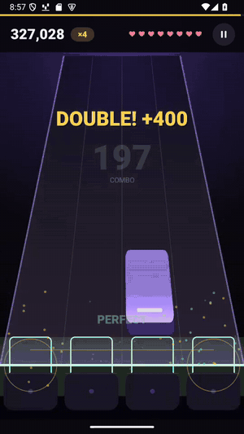
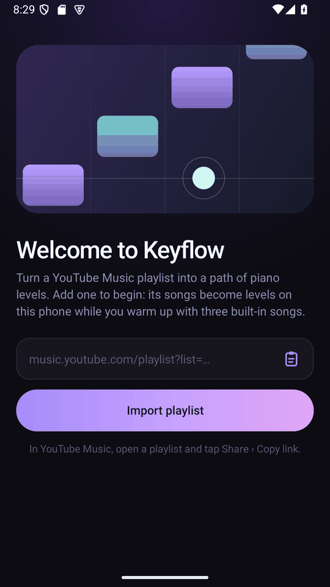
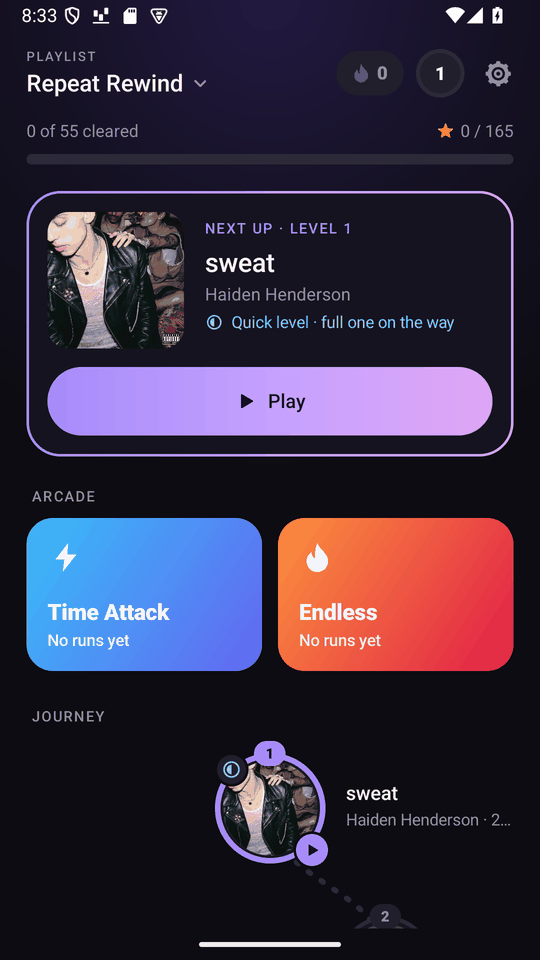
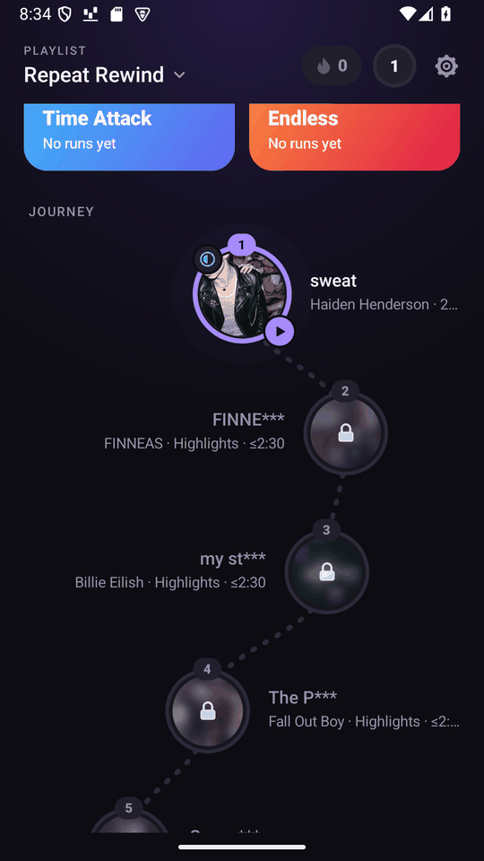
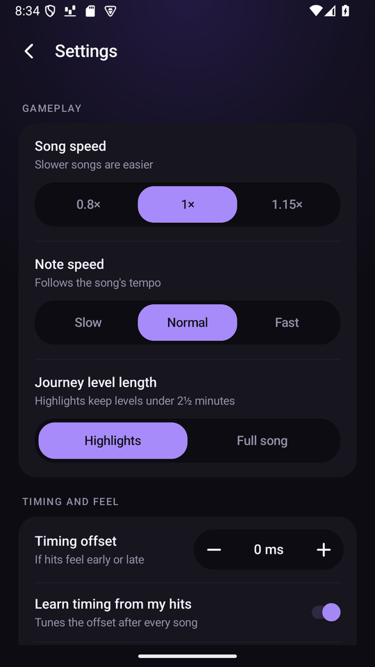

<p align="center"></p>

<h1 align="center">Keyflow</h1>

<p align="center"><b>A free piano-tiles style rhythm game for Android that turns your own YouTube Music playlist into levels.</b></p>

<p align="center">
  <a href="https://github.com/oskarsss/keyflow/releases/latest"></a>
</p>

<p align="center">
  
  &nbsp;
  
</p>

Tiles fall to the beat of the music, and you tap them as they reach the line. Instead of a fixed song list, you paste a link to any YouTube Music playlist, and every song on it becomes a level, with tiles made from the music itself. Everything happens on your phone: no account, no ads, no computer needed.

## How to start

1. **Download** `keyflow-X.Y.Z.apk` from the [latest release](https://github.com/oskarsss/keyflow/releases/latest) on your Android phone (Android 8.0 or newer).
2. **Install it.** Open the downloaded file. If your phone asks, allow your browser or file manager to install apps.
3. **Add a playlist.** In YouTube Music, open a playlist and tap *Share › Copy link*, then paste it into Keyflow. The playlist must be public or unlisted.
4. **Play.** Your first level is ready in under a minute. Until then, you can warm up with three built-in songs.

<p align="center">
  
  
  
  
</p>

## What you get

- **A journey through your playlist.** Each song is a level on a map. Clear one to unlock the next.
- **More than just taps.** Hold long tiles, slide along curves, hit chords with two fingers, grab gold tiles and dodge bombs.
- **Arcade modes.** *Time Attack* and *Endless* mix short parts of the songs you've unlocked.
- **Stars, combos and streaks.** Score up to three stars per song, build combos and keep a daily streak.
- **Plays offline.** Once a song is downloaded, you can play it anywhere.
- **Fits your phone.** Keyflow learns whether your taps land early or late and adjusts the timing for your phone and headphones.

## Good to know

- The app is big, about 160 MB, because the music analysis runs on the phone. Each song you download takes extra space; Settings shows how much and lets you free it.
- Songs download in the background, by default only on Wi-Fi, except for your next couple of levels.
- Private playlists and songs that YouTube blocks in your country can't be used.
- This is still in development: an update may reset your playlists and scores.
- If downloads stop working, try *Update downloader* in Settings.

## Features in detail

- **First start.** Keyflow asks for a playlist before anything else. While its first levels download and are built, you can warm up with three built-in songs, *The first notes*; a card on their home screen says when your playlist is ready and switches to it.
- **Playlists.** Paste a public or unlisted playlist link, or share one to Keyflow from YouTube Music. Each import becomes a new local playlist with its songs shuffled once; the order then stays fixed. Downloads, scores and unlocks are shared per song across playlists. Imports of more than 100 songs ask for confirmation, because of storage.
- **Journey.** Each song is a level on a winding map. Clear a level to unlock the next; locked covers are blurred and their titles show only their first five characters. Long songs play one of up to five continuous, bar-aligned highlights of up to 2½ minutes, a different one from last time, or the full song if chosen in Settings.
- **Gameplay.** Tap tiles, hold green ribbons, follow blue slides, tap linked chords together, catch gold tiles for points and a life, and avoid bombs. New tile kinds appear gradually. You have eight lives: a miss costs one and a 25-hit streak earns one back. Combos raise a multiplier up to ×4. Hit 75% of the notes to clear a level; stars come from accuracy. Each play uses a new two-thumb lane layout with the same rhythm.
- **Arcade.** *Time Attack* (1, 2, 3 or 5 minutes) and *Endless* (lives carry over and each song is faster) play random 45-second parts of songs from the levels you have reached.
- **Progression.** Runs earn XP toward your player level, and playing on consecutive days builds a streak.
- **Timing.** After each song, Keyflow measures whether your hits leaned early or late and adjusts the timing offset, which differs between phones and headphones. It can also be set by hand.
- **Settings** are grouped into gameplay, timing and feel, storage (space used and free, the song queues and each playlist's downloads), downloading, freeing up space and troubleshooting. They include whether *Download ahead* and *Download all* wait for Wi-Fi (on by default) or a charger. Your next two levels and Arcade's songs download on any connection, and downloaded songs get their levels made on any connection. *Song queues* shows the songs still to download and the levels still to make, each in order, with an estimate for each song. Each playlist has its own settings, under the gear on the Playlists screen: how many levels to keep ready, keeping its songs, downloading or removing them, renaming and deleting. A playlist whose next level isn't on the phone yet is greyed out with an estimate of when it can be played.
- **Quick levels.** Every downloaded song gets a quick level in a couple of seconds from a small model distilled from the full chart model, matching most of its tiles, so you can play it right away. The higher quality full level replaces it once it's ready; a badge marks songs still on their quick level, another marks songs not downloaded yet, and tapping either shows the work step by step with the time left. *Settings › Make full levels* turns full levels off to keep only quick ones.
- Songs are downloaded and their levels made side by side in a foreground service that keeps the phone awake while it works, so it continues at full speed with the screen off; making levels eases off while you play. Prepared songs play offline. Three original piano pieces ship with the app.

Charts come from the human-chart-trained [Mapperatorinator-v32-mini](https://huggingface.co/OliBomby/Mapperatorinator-v32-mini) mania model, adapted to run locally and conditioned on beats from [Beat This!](https://github.com/CPJKU/beat_this). See [the chart model](docs/chart-model.md) and [beat tracking](docs/beat-tracking.md). Downloading uses runtime and request handling adapted from [YTDLnis](https://github.com/deniscerri/ytdlnis).

Each song has a 20-minute / 100 MB limit. Songs YouTube won't play in your country, or at all, are taken out of the playlist with a note saying which. Private playlists that need an account are not supported. Use audio you have permission to download and play. If YouTube blocks requests or changes, retry or use **Update downloader** in Settings, which verifies the official yt-dlp nightly's SHA-256 before installing it, or says the downloader is already up to date.

### Which APK

Each [release](https://github.com/oskarsss/keyflow/releases) has `keyflow-X.Y.Z.apk` for **phones** (ARM64) and `keyflow-X.Y.Z-x86_64.apk` for **x86-64 emulators**, both for Android 8.0 (API 26) or newer. The bundled models, Python, FFmpeg and QuickJS make each about 160 MiB.

Development releases don't keep data between versions: playlists, downloads, scores and settings may need to be cleared after an update.

## Develop

Requires JDK 21, Python 3, Android SDK platform 35 and build tools 36.0.0. Open the root in Android Studio, or use the Gradle wrapper:

```bash
./gradlew :app:assembleDebug
adb install -r app/build/outputs/apk/debug/app-debug.apk
```

The build runs `tools/prepare_android_runtimes.py`, which downloads the two official YTDLnis 1.9.0 APKs, checks their pinned SHA-256 hashes and extracts only the Python, FFmpeg and QuickJS libraries into the ignored `app/src/main/jniLibs/`. The yt-dlp nightly 2026.10.10.233141 ships as an asset. Neither needs to be installed on the build computer.

[Architecture](docs/architecture.md) describes the packages, how a playlist becomes a level, what is kept ready and where data is stored.

### Test

```bash
./gradlew :app:testDebugUnitTest :app:lintDebug
python3 -m unittest discover -s tools -p 'test_*.py'
./gradlew :app:connectedDebugAndroidTest
```

Unit tests run on the JVM, with Robolectric for screens. They cover gameplay, timing, charts, the model frontends, playlists, downloads, storage and Arcade. Device tests play the built-in levels with real touch events against the media clock, run the native models and downloader, and play both Arcade modes offline. Optional live tests import a real playlist:

```bash
adb shell am instrument -w -r \
  -e playlistUrl 'https://music.youtube.com/playlist?list=PLA2wtd_DK6uw' \
  io.github.oskarsss.keyflow.test/androidx.test.runner.AndroidJUnitRunner
```

### Release

Bump `versionCode` and `versionName` in `app/build.gradle.kts`, commit, then publish a GitHub release whose tag matches `versionName` (for example `v1.6.2`). `.github/workflows/release.yml` then runs the tests and lint, builds the signed APKs with `tools/build_release.py`, and attaches the phone and emulator APKs, a source archive and `SHA256SUMS`. It needs the Actions secrets `KEYFLOW_KEYSTORE_BASE64`, `KEYFLOW_STORE_PASSWORD` and `KEYFLOW_KEY_PASSWORD`.

To sign locally, set `KEYFLOW_KEYSTORE`, `KEYFLOW_STORE_PASSWORD` and `KEYFLOW_KEY_PASSWORD` and run `./gradlew :app:assembleRelease`, or `python3 tools/build_release.py` from a clean, committed tree. Without them, release builds are unsigned. Release builds are shrunk with R8 and come as one APK per processor, in `app/build/outputs/apk/release/`.

### Tools

- `tools/prepare_android_runtimes.py` prepares the checksum-pinned native runtimes.
- `tools/prepare_rhythm_model.py` and `tools/prepare_chart_model.py` verify the bundled models, or reproduce their pinned conversions.
- `tools/evaluate_rhythm.py` scores beat tracking against human annotations.
- `tools/generate_demo.py` regenerates the original built-in songs and their charts.

## Source and credits

The app is GPL-3.0; see `LICENSE` and `THIRD_PARTY_NOTICES.md` for reused YTDLnis code, native runtime provenance, model licenses and the MIT particle adaptation. License texts ship in the APK, and releases include this project's source archive.

## Disclaimer

Keyflow is an independent project. It is not affiliated with, endorsed by or sponsored by Google, YouTube or YouTube Music, or by the makers or publishers of Piano Tiles or any other commercial game; these names belong to their owners and are used only to describe what Keyflow works with or resembles. No commercial game's source, branding or audio is included.

Keyflow ships no music. You are responsible for having the rights to download and play the audio you import, and for following the terms of the services you use.
